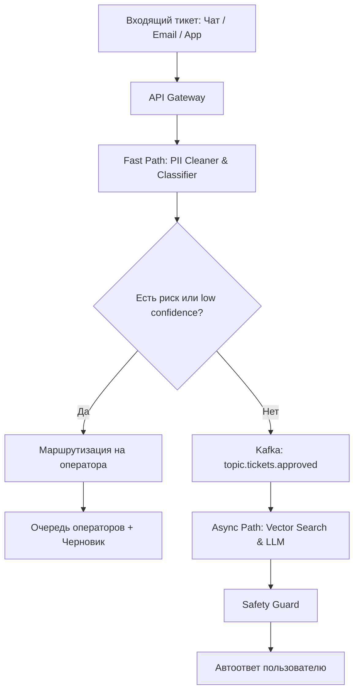

# Архитектура системы и схема потоков данных

## 1. Компоненты и Data Flow

---

## 2. Разделение Fast Path и Async Path

Система разделена на два независимых контура для соблюдения жесткого SLA на первом этапе:

### Fast Path (Синхронный контур, SLA < 150 мс)
* **Назначение**: Мгновенная первичная фильтрация и принятие решения о маршрутизации.
* **Задачи**:
  1. Очистка персональных данных (PII) — номера банковских карт, телефоны, email.
  2. Определение категории обращения и расчет уровня уверенности (Confidence Score).
  3. Проверка на рискованные темы (возвраты денег, юридические претензии, блокировки).
* **Технологии**: Python / Go, CatBoost / TF-IDF, Natasha / Regex.
* **Результат**: Отправка тикета в Kafka для генерации автоответа ЛИБО мгновенная эскалация на оператора.

### Async Path (Асинхронный контур, SLA 2–4 сек)
* **Назначение**: Безопасный поиск контекста в базе знаний и генерация ответа.
* **Задачи**:
  1. Векторный поиск релевантных статей в базе знаний (RAG).
  2. Инференс локальной LLM для сборки вежливого ответа.
  3. Проверка ответа на отсутствие галлюцинаций (Safety Guard).
* **Технологии**: Kafka, Qdrant / Milvus, vLLM (Qwen2.5-32B).
* **Результат**: Доставка автоответа пользователю в чат или на email.

---

## 3. Обработка пиковой нагрузки (20 000 тикетов / 10 минут)

Во время аварий на инфраструктуре (сбой эквайринга, недоступность сайта) поток тикетов возрастает в 20 раз. Для защиты от падения применяются три механизма:

1. **Буферизация через Kafka**: API Gateway мгновенно складывает все входящие обращения в топик `tickets.ingress`. Это предотвращает потерю сообщений при всплесках.
2. **Инцидентная дедупликация**: При обнаружении кластера схожих сообщений (> 50 тикетов за 3 минуты по одной теме) система переходит в режим аварии. Входящим тикетам автоматически присваивается тэг инцидента и отправляется массовый шаблонный ответ без вызова LLM.
3. **Circuit Breaker**: Если лаг очереди Kafka перед LLM-воркерами превышает 5000 сообщений, система временно отключает асинхронную генерацию и переводит все входящие тикеты на стандартный роутинг операторам.

---

## 4. Хранилища данных

* **Redis**: Семантический кэш повторяющихся ответов (Semantic Cache) и Rate Limiter по IP/user_id.
* **Qdrant**: Векторная база данных для хранения эмбеддингов статей базы знаний.
* **PostgreSQL**: Хранилище метаданных тикетов, статусов обработки и сессий пользователей.
* **ClickHouse**: OLAP-хранилище для аудита всех принятых решений, логов классификатора, ответов LLM и метрик качества.
